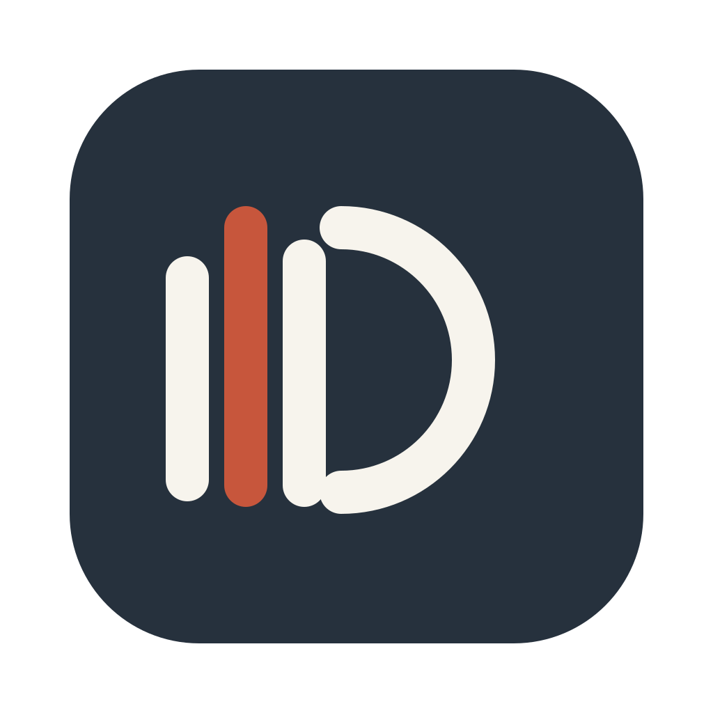
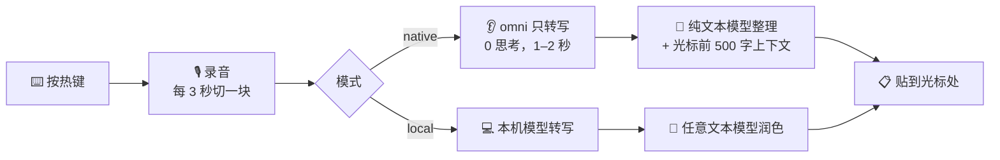

<p align="center">
  
</p>

<h1 align="center">Draftless</h1>

<p align="center">
  <b>按一下热键说话，再按一下，整理好的文字就贴进你正在打字的框里。</b><br />
  Windows 上的开源语音输入。用你自己的 Gemini、OpenAI 或 Qwen 的 key，不经过任何中间服务器。
</p>

<p align="center">
  
  
  
  <a href="LICENSE"></a>
</p>

---

## 装

**要求**：Windows 10 1809 以上（推荐 Windows 11）、64 位；一把模型 key（下面第 4 节说去哪申请，三家都有免费额度）。

### 装（就这一步）

1. 打开 **[Releases 页面](https://github.com/lijiatu-1/draftless/releases/latest)**
2. 下载 **`Draftless-win32-x64.zip`**（约 267 MB，别的文件不用管）
3. 解压到任意位置
4. 在解压出来的那个目录里，右键 `install.ps1` → **使用 PowerShell 运行**
   （或者在那个目录里跑 `powershell -ExecutionPolicy Bypass -File install.ps1`）
5. 装完后按 `Win` 键搜 **Draftless**，或者重开一个终端敲 `draftless`

> **SmartScreen 会拦一下**：这个程序没有代码签名（签名要证书），第一次运行 Windows 会提示"已保护你的电脑"。点 **更多信息 → 仍要运行** 就行。

### 装完之后

程序在 `%USERPROFILE%\.draftless\app\`，数据（设置、历史、key）在 `%USERPROFILE%\.draftless\` 根下。
**升级时只覆盖 `app\`，你的设置和历史不动。**

不想要了：`draftless uninstall`（会先列出来要删什么）。想留着历史只删程序加 `--keep-data`。

---

## 怎么用

1. 第一次启动会带你填一把 key、试一下麦克风。
2. 随便点进一个能打字的框，**按一下热键**（默认右 <kbd>Alt</kbd>）。
3. 说话。屏幕底下的悬浮条跟着声音动。
4. **再按一下**（或者点条上的 ✓）。文字就贴进你刚才那个框里了。按 <kbd>Esc</kbd> 是取消。

Draftless 平时待在托盘里，不占任务栏。右键托盘图标可以打开主窗口：字数、省下多少时间、速度和热力图，历史记录，以及设置（热键、主题、语言、模型）。

**它不只是把话转成字**，还会帮你整理：

| 你说 | 它写 |
| --- | --- |
| 那个咱们晨会能不能，呃，改到九点？…啊不对，还是改到九点半吧 | 咱们晨会能不能改到九点半？ |
| 你好小明，我换新号码了，是13812345678。哦对，小明是黄晓明的晓明 | 你好，晓明，我换新号码了，是 138 1234 5678。 |
| 我的读书列表，一个是《活着》，还有一个是第一部哈利波特 | 我的读书列表是：《活着》《哈利·波特与魔法石》 |
| 周五出门前先网上值机，然后收拾行李箱，再把停车位订了。停车位得先订，车位老是一下就没了 | 周五出门前还有几件事：<br>1. 先订机场停车位（得先订，那个便宜的车位老是一下就没了）<br>2. 提前网上值机<br>3. 收拾行李 |

它会删填充词、合并重复、听懂你的改口、把模糊的指代补全、按你说的轻重排顺序、把顺口的解释放进括号。
**但你说话里的事实（数目、时间、人名、承诺）它一个字都不改。**

---

## 要有哪家的 key

启动时会让你选一家，然后去对应的地方申请，粘进 Draftless 就行。key 用当前用户的 DPAPI 加密，只存在你这台机器上。

| 厂商 | 去哪申请 | 大概多少钱 | 备注 |
| --- | --- | --- | --- |
| **Gemini** | [aistudio.google.com/apikey](https://aistudio.google.com/apikey) | 有免费额度 | 需要能访问 Google |
| **OpenAI** | [platform.openai.com/api-keys](https://platform.openai.com/api-keys) | 按量付费 | gpt-audio 系列 |
| **Qwen**（阿里云百炼） | [bailian.console.aliyun.com](https://bailian.console.aliyun.com/) | 按量付费 | 国内直连、不用代理；听写默认 `qwen3.5-omni-plus` |

命令行也能填：`Get-Clipboard | draftless key qwen`（别直接把 key 写在命令里，会进 shell 历史）。

---

## 它能做什么、不能做什么

**能做**

- 说完就贴，不问第二遍；贴不进去时文字会留在剪贴板并提示你按 <kbd>Ctrl</kbd>+<kbd>V</kbd>
- 会读你光标前的文字（最多 500 字）当上下文，用来判断你在写代码还是在写邮件
- 两种模式：**native**（录音直接交给模型，一次调用）和 **local**（本机小模型先转写，再交给文本模型润色）
- 历史、花费、速度都在主窗口里，数据全在本地
- 界面中英双语，三套主题

**不能做 / 还差的**

- **热键是单个修饰键，不是组合键。** 右 Alt 在带菜单栏的程序（资源管理器、浏览器）里按一下会去聚焦菜单——这是 Windows 的行为。嫌碍事可以换右 Ctrl（`draftless config set hotkey right_ctrl`）
- **贴不进管理员权限的程序。** Windows 的 UIPI 不允许低权限进程往高权限窗口发按键；这时文字留在剪贴板
- **人名和专业术语可能听错。** 我们没有原版那种屏幕可见文字的采集，只有光标前那一小段
- **local 模式没在 Windows 上实测过一轮。** 模型和运行库都在，但速度和准确率没在这类机器上验证
- **自动更新只做了一半**：会告诉你有没有新版本，换程序要按提示自己装
- 只有语音输入：没有翻译，也没有"问点什么"。悬浮条只出现在主显示器上

---

## 命令

<details>
<summary><b>展开全部命令</b></summary>

| 命令 | 做什么 |
| --- | --- |
| `draftless` | 启动。已经在跑就显示状态；还没有 key 时会问 |
| `draftless stop` / `restart` | 停掉 / 重启，卡住了也能停 |
| `draftless status [--json]` | 在不在跑、key、麦克风和两把钩子、今天和累计说了多少 |
| `draftless history [-n 条数] [--json]` | 说过的话。失败的会写上原因，录音留着 |
| `draftless usage [--json]` | 花了多少钱、多少 token、模型多久回话，按型号分开 |
| `draftless mode [native\|local]` | 看两种模式 / 切换。当场生效，先查 key |
| `draftless model` / `model <厂商>[/<模型>]` / `model check` | native 模式用哪一家哪个模型 |
| `draftless transcriber [...]` | local 模式第一步：本机模型，含下载、删除、检查 |
| `draftless polish [...]` | local 模式第二步：谁润色 |
| `draftless key [<厂商>]` / `key --forget` | 换 / 删 key |
| `draftless config` / `config set <名字> <值>` / `config unset <名字>` | 看设置 / 改一项 / 回到默认 |
| `draftless theme [名字]` | 看有哪几套主题 / 换一套，当场生效 |
| `draftless settings` | 打开设置 |
| `draftless logs [-n 行数] [-f]` | 看日志，`-f` 一直跟着 |
| `draftless uninstall [--keep-data]` | 卸载。会先说要删什么 |

</details>

## 设置

<details>
<summary><b>展开全部设置项</b></summary>

| 名字 | 默认 | 能填什么 |
| --- | --- | --- |
| `hotkey` | `right_alt` | `right_alt` / `right_ctrl` / `right_shift` / `right_win`，都是单按一下 |
| `mode` | `native` | `native` / `local` |
| `model` | `gemini/gemini-3.6-flash` | native 模式：`厂商/模型`，可选 `gemini` / `openai` / `qwen` |
| `thinking` | `MINIMAL` | `MINIMAL` / `LOW` / `MEDIUM` / `HIGH`，只有 Gemini 有 |
| `transcriber` | `qwen3-asr-0.6b-q8` | local 第一步的本机模型 |
| `polish` | `deepseek/deepseek-flash` | local 第二步：`deepseek` / `qwen` / `custom/<模型>`，例如 `qwen/qwen-plus` |
| `customUrl` | 空 | 自定义润色服务的地址 |
| `modelSource` | `cn` | 本机模型从哪下：`cn` / `original` |
| `theme` | `ink` | `ink` / `cinnabar` / `indigo` |
| `language` | `system` | `system` / `en` / `zh-CN` |

设置存在 `%USERPROFILE%\.draftless\settings.json`。也可以用环境变量临时盖一次：`DRAFTLESS_HOTKEY`、
`DRAFTLESS_MODE`、`DRAFTLESS_MODEL`、`GEMINI_THINKING_LEVEL`、`DRAFTLESS_TRANSCRIBER`、`DRAFTLESS_POLISH`、
`DRAFTLESS_CUSTOM_URL`、`DRAFTLESS_MODEL_SOURCE`、`DRAFTLESS_THEME`、`DRAFTLESS_LANGUAGE`，
`DRAFTLESS_QWEN_BASE_URL`（把 Qwen 的地址换到国际站或自建网关），key 用
`GEMINI_API_KEY`、`OPENAI_API_KEY`、`DASHSCOPE_API_KEY`（Qwen）、`DEEPSEEK_API_KEY`、`DRAFTLESS_CUSTOM_API_KEY`。

</details>

## 东西都在哪

<details>
<summary><b>展开目录说明</b></summary>

全在 `%USERPROFILE%\.draftless\` 下：

| 什么 | 在哪 |
| --- | --- |
| 设置 | `settings.json` |
| 加密的 key | `<厂商>-key.bin`（当前用户的 DPAPI 加密） |
| 历史、录音、花费 | `data\history.db`、`data\Recordings\` |
| 日志 | `logs\main.log`（只有长度、耗时、用量，没有说过的话，也没有 key） |
| 本机模型 | `models\`（用到时你点了才下，下完核对 SHA-256） |
| 装好的程序 | `app\`、`runtime\` |

</details>

## 热键没反应

<details>
<summary><b>按症状查</b></summary>

先按 `draftless status`：`Keyboard hook`、`Click interception` 两项应该都是 ✓。

| 看到 | 怎么办 |
| --- | --- |
| `Click interception` 不是 ✓ | 安全软件拦了鼠标钩子。把 Draftless 加进白名单，再点设置里的"检查一遍" |
| 两项都不是 ✓ | 键盘钩子没装上：多半是安全软件拦了，或者进程没有桌面会话 |
| 都 ✓ 但按了没反应 | 换一个热键试试（`draftless config set hotkey right_ctrl`）：右 Alt 在有的程序里会去聚焦菜单 |
| 悬浮条出来了但没贴出字 | 目标程序是管理员权限的，UIPI 挡了；文字在剪贴板里，按 Ctrl+V |
| 等很久才出字 | 录音越长处理越久（60 秒录音约 3–5 秒）。日志里 `refined` 那行的 `refine_ms` 是实际耗时 |
| "它没有在 5 秒内回话" | 后台卡住了：`draftless stop`，再 `draftless` |

</details>

---

## 怎么做的



- **Electron + 一个 C# 写的小帮手。** 小帮手（`native-win/`）负责四件主进程做不了的事：听全局热键、
  模拟 Ctrl+V 把文字贴进当前输入框、听写中拦下 `Esc` 和悬浮条上的点击（拦不下来的话，按 Esc 会顺手关掉
  你正在用的那个程序的对话框）、读焦点输入框里光标前的文字。它和主进程用"一行一个 JSON"说话。
- **两跳整理。** 听音频的模型本职是"听懂声音"，文字加工不是它的强项——让它一次干两件事，结果是"带标点的听写"。
  所以 Qwen 这条路拆成两跳：`qwen3.5-omni-plus` 只负责听（1.4–2.4 秒、不产生思考 token），
  逐字稿交给纯文本的 `qwen-plus` 整理。Gemini 和 OpenAI 仍是一次调用。
- **上下文。** 收到"录音结束"的那一刻读一次光标前的文字（最多 500 字，200–400 ms 超时，读不到就算了），
  一起交给整理那一步，让它知道你在写代码还是写邮件。
- **你的数据留在你的机器上。** 不经过中间服务器，没有账号，没有统计。key 用当前用户的 DPAPI 加密，
  历史从来不出这台机器。
- **照着逆向笔记实现。** 动手之前先把 [Typeless 客户端逆向了一遍](docs/targets/typeless/README.md)（18 篇中文笔记：
  进程架构、语音链路、网络协议、上下文采集、状态机、投递……），按它的协议和交互重建，没有用它的任何代码。
  Windows 上每一处平台差异为什么这么处理，记在[移植笔记](docs/windows-port.md)里。

## 开发

```powershell
git clone https://github.com/lijiatu-1/draftless.git
cd fast-speak
npm install            # 装完会自动把 Electron 的二进制补上（见下）
npm run native         # 编原生小帮手（第一次 npm start 时也会自动编）
npm start              # 就是 draftless 命令；子命令写在 -- 后面，比如 npm start -- status
npm run check          # 代码检查 + 全部测试（不联网、不开窗口）
```

需要 Node 22.13 以上（用 23 的话要 23.4 以上）。Windows 上不用另装编译器：原生小帮手用系统自带的
.NET Framework 4 里的 `csc.exe` 编（UI Automation 要引用 WPF 目录下那几个程序集，`native-helper.mjs` 里处理了）。

```powershell
npm run dist       # 打成 dist\Draftless-win32-x64\，双击里面的 Draftless.exe
npm run dist:zip   # 再压成发布用的 zip（737 MB → 267 MB）
npm run icons      # 从 assets 里的 svg 重新生成 app.ico / tray.ico
```

目录结构、每一块怎么分工，见[开发说明](docs/development.md)；这一版到底实测到了哪一步（含踩过的坑和错过的方向），
见[验证记录](docs/verification.md)。

<details>
<summary><b>关于 Electron 二进制</b></summary>

`node_modules/electron` 只是几十 KB 的壳，真正的运行时是 150 多 MB 的 zip。这个仓库的 `npm install`
后面接了一个 `postinstall`（`scripts/build/fetch-electron.mjs`）：用 PowerShell 下载、
按 electron 包自带的 `checksums.json` 核对 SHA-256、再解到该在的位置。

为什么不用 electron 包自带的那条路：在这台机器上它走 `@electron/get` 会报 `fetch failed`，
而同样的地址用 PowerShell 是通的。校验值不对时会重新下一次，还不对就报错，不会留一份坏的在磁盘上。

</details>

## 许可

[MIT](LICENSE)。

名字是向 Typeless 致意。Draftless 是照着逆向笔记独立实现的，和 Typeless 没有任何关系。
