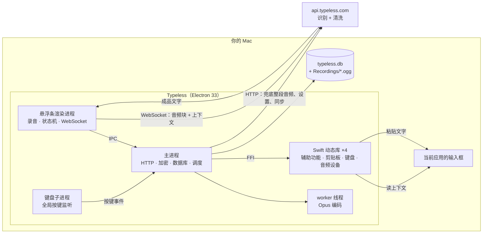

# 00 总览

## 一句话

Typeless 的客户端很薄：它负责录音、压缩、收集"你正在哪个输入框里打字"的上下文，然后把声音和上下文一起交给服务端；识别和文字清洗全部在服务端完成，客户端拿回成品文字后用"写剪贴板 + 模拟 ⌘V"贴进当前应用。

所以"转写清洗牛"的原因不在这个安装包里，在服务端的模型和提示词，客户端里看不到。客户端能看到的是它**喂给服务端什么**和**怎么做到快**。

## 它为什么快

1. **边说边传**。录音时每 3 秒切一块，压成 Opus，经 WebSocket 实时发给服务端。你结束录音时，服务端已经拿到了除最后一块外的全部音频。实测结束后 1.4–1.9 秒成品就回来了（4 次 13 秒以内的听写）。
2. **两条路赛跑**。结束时客户端同时准备一份完整音频走普通 HTTP 接口作兜底；WebSocket 先回就用它并取消 HTTP，网络差时直接改走 HTTP。
3. **上下文分两次给**。开始录音时先发一份轻量上下文（当前应用、输入框、光标前后文字），较重的那份（屏幕可见文字、输入框周围内容）在录音过程中补发，不占用结束后的等待时间。
4. **音频很小**。16 kHz 单声道、32 kbps 的 Opus，本机 3120 条录音合计 25 小时只有 253 MB。

有两件事它没有做，和直觉相反（抓包看到的，见 [09](09-runtime-capture.md#结果)）：

- **录音过程中服务端不回识别文字。** 服务端对每一块只回一个"收到"，成品在音频收齐后一次给出。
- **连接不是常连的。** 语音通道在应用启动时预先连上，但空闲 60 秒就被服务端断开，也没有保活；下次按键时重连。隔了一会儿再用的第一次听写，开始消息要等重连完成才发出去（实测那一次是按下后 1.2 秒，平时是 0.1–0.2 秒），录音本身不受影响。

## 架构

## 一次听写发出去的东西

| 内容 | 说明 |
| --- | --- |
| 音频 | Opus/Ogg，16 kHz 单声道 |
| 当前应用 | 名称、bundle id、窗口标题、窗口位置、进程号、应用路径；浏览器还有网页标题、网址、域名 |
| 输入框 | 类型、辅助功能角色、屏幕位置、是否可编辑、DOM id 和 class |
| 光标状态 | 光标位置、选中的文字、**光标前文字（实测上限 5000 字符）、光标后文字、整个输入框内容** |
| 输入框周围 | 输入框之前和之后各约 1000 字符的内容（黑名单应用/网址不采） |
| 屏幕可见文字 | 当前窗口可见文字，上限约 10000 字符（黑名单应用/网址不采） |
| 设备环境 | 系统版本、芯片架构、CPU 核数、内存大小、语言和地区、机型、开机时长 |
| 采集质量 | 上面每一项采没采到、花了多久、是否被截断、失败的错误码 |

上下文在发出前用服务端下发的 RSA 公钥加密，本机数据库里存的也是这份密文，本地读不回明文。详见 [06](06-context-capture-and-privacy.md)。

实际的量差别很大。抓到的 4 次里，上下文明文最小 1.8 KB（微信，焦点没取到），最大 55.7 KB（iTerm2）。

## 值得知道的行为

- **文字贴进去之后它还会看一会儿**。插入后约 15 秒内（期间你每改一次就重新计时），它每秒读一次那个输入框的内容，判断你有没有手动改它给的文字；结束时把"它给的原文、改之前的输入框内容、改之后的输入框内容、当前应用信息"发到 `/user/traits`。服务端可能据此自动往你的个人词典里加词。见 [06](06-context-capture-and-privacy.md#插入后的修改跟踪)。
- **每秒一次的焦点轮询是常开的**。应用启动后就以 1 秒间隔读取"当前应用 + 当前输入框"的基本信息。平时这份轮询不读文字内容，只在上面的修改跟踪期间才带上输入框文字。
- **它看得见你敲的每个键名**。全局按键监听把当前按住的键都传回应用，用于快捷键判定、修改跟踪，以及统计你最近一分钟敲了多少键来提示"试试语音"。读过的代码里这些只在内存里用，没有上传。见 [10](10-interaction-state-machine.md)。
- **在终端里听写，终端里的内容会一起上传**。终端的整个文字区在系统看来是一个输入框，所以"输入框全文"就是终端最近的输出。实测在 iTerm2 里说一句话，随之发出的是光标前 5000 字符、屏幕可见文字 10000 字符和周围内容近 1000 字符。iTerm2 不在 macOS 的黑名单里。终端里刚显示过的密钥和内部数据也在其中。见 [06](06-context-capture-and-privacy.md#实测到的量)。
- **黑名单只挡一部分**。微信、Excel、WPS、Sublime Text、Zed 在内置黑名单里，谷歌文档和腾讯文档按网址前缀在黑名单里。被挡的是"屏幕可见文字"和"输入框周围内容"；从代码看，光标前后文字和输入框全文不受黑名单影响。抓包里微信那次确实没有去采前两项、去采了光标文字，但因为焦点输入框没取到，采集失败了，所以"光标文字真的发出去"还没有直接看到。这份名单的本意也不是隐私分级，而是"哪些应用的辅助功能信息靠不住"，见 [14](14-result-delivery.md#落进输入框之后)。
- **聊天软件里别人的消息会被采**。不在黑名单里的聊天应用（实测是飞书），聊天窗口里的可见文字和输入框前后的内容会随听写上传。
- **检测不到输入框时会上报应用名**。实测 Chrome 和微信各有一次取不到焦点输入框，客户端随即发了一条统计事件，带应用名、包名和网页域名。
- **这一版没有"按住说话"**。按住听写键超过 600 ms 会取消录音并提示"按一下就行"；只有"按一下开始、再按一下结束"一种用法。静态结论，见 [10](10-interaction-state-machine.md)。
- **怎么交付结果由服务端说了算**。"问任何事"的成品带一个 `delivery` 字段，决定是贴进输入框、弹结果卡片还是打开一个网址。见 [14](14-result-delivery.md)。
- **本地令牌文件的加密形同虚设**。登录令牌存在 `user-data.json`，加密密钥由操作系统、芯片架构、应用名这些公开信息派生，没有用系统钥匙串。见 [12](12-account-and-login.md)。
- **屏幕录制权限目前没被用到**。代码里只有申请这项权限的预留逻辑，没有截屏或录系统声音的路径；"可见文字"是通过辅助功能读的。摄像头和蓝牙的权限声明是打包模板带出来的。见 [15](15-update-policy-permissions.md#权限)。

## 对自己搓一个的启示

- 客户端的全部难点在三件事：全局热键、读焦点上下文、向任意应用注入文字。这三件在原生库里各对应一组很标准的系统 API，见 [07](07-native-helpers.md)。
- 服务端接口面很小：一条 WebSocket 加一个 HTTP 接口就是主链路，见 [05](05-network-protocol.md)。
- 客户端留了一个开发开关 `__DEV_API_HOST`，能把所有请求改指向任意主机。这既是我们抓包的入口，也意味着原版客户端可以直接对接自建服务端做对照实验。

## 证据的可信程度

- 包结构、签名、接口表、原生库用到的系统 API：直接从发行包读出，可靠。
- 主链路的行为描述：来自还原后的代码。其中普通听写这一条路在 2026-10-13 抓包验证过（4 次听写，消息顺序、字段、上下文明文、与本机数据库的对应关系），并据此改了 6 处静态结论，见 [09](09-runtime-capture.md#被纠正的静态结论)。
- 没有在运行中验证的：翻译、"问任何事"、HTTP 兜底、修改跟踪上报、按住和取消、云同步、登录。这些仍是静态结论。
- 服务端做了什么：不知道。
