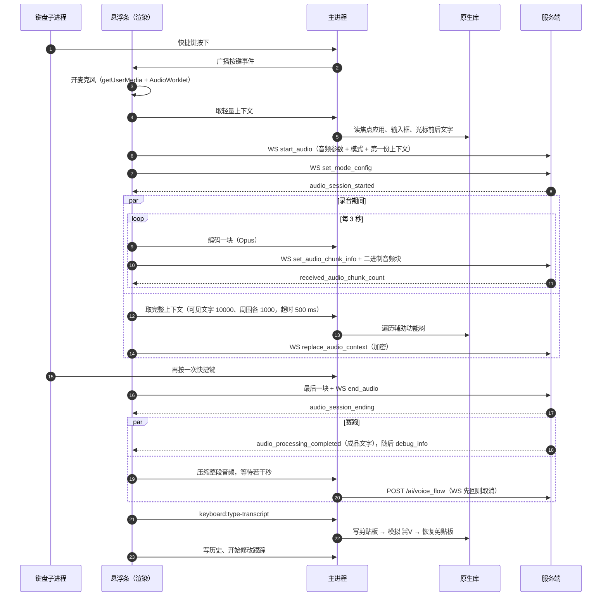

# 04 语音主链路

从按下快捷键到文字出现在输入框。主体是静态阅读的结论；普通听写的消息顺序、字段和耗时已经用抓包对过（[09](09-runtime-capture.md#结果)，2026-10-13，4 次听写），下面的时序图按抓包结果画。标"实测"的来自抓包或本机数据库的真实记录，其余来自代码。

## 时序



## 分步说明

### 1. 触发

全局按键由键盘子进程里的 `libKeyboardHelper` 监听（事件监听机制见 [07](07-native-helpers.md)）。主进程把目标快捷键列表下发给它（`updateTargetShortcuts`），按键事件经回调传回 JS，再广播给悬浮条。

悬浮条里跑一个 XState 状态机管理整个流程（`dist/renderer/static/js/qA149QP2.mjs`，约 5700–6600 行）。

### 2. 录音

- 渲染进程 `getUserMedia` 取麦克风，经 `AudioWorkletNode("typeless-audio-capture")` 拿 PCM（readable:UfR9-a2Z.js:11877、14099）。
- 发给服务端的音频参数（实测，本机最新记录的 `audio_metadata`）：

  ```json
  {"audio_duration":3,"audio_format":"ogg","audio_bitrate":32000,"audio_channels":1,
   "audio_sample_rate":16000,"audio_codec":"opus","audio_variable_bitrate":true,
   "audio_bit_depth":16,"need_merge":true}
  ```

  `audio_duration: 3` 是分块时长（秒）。`need_merge: true` 告诉服务端这些块要拼起来。
- 设置项 `enabledOpusCompression` 关闭时走 WAV/PCM（`audio_format: "wav"`、`audio_codec: "pcm"`），代码里两条路都在。

### 3. 编码

Opus 编码不在渲染进程做，交给主进程的 worker 线程池：

- 分块：`audio:opus-chunk-session-start` → `-encode` → `-end`，worker 里用 koffi 调 `libopuschunk`（`libopuschunk_session_create(int,int,int,int)` 等）。
- 整段：`audio:opus-compress-by-audio-id`，调 `libopusenc` 的 `opus_convert_advanced` / `opus_convert_buffer`。只给 HTTP 兜底和重试用。

本机最新记录里整段压缩耗时 `full_audio_compression_time_ms: 601.5`（实测）。

### 4. 上下文

分两次取，两次都走 `audio-context:get-audio-context`：

| 时机 | 参数 | 内容 |
| --- | --- | --- |
| 开始录音时 | `inputStateParams: []` | 应用、输入框、光标前后文字。保存为会话初值，并放进 `start_audio` 消息一起发出（实测） |
| 录音过程中 | `visibleTextParams: [10000, {timeout: 500}]`、`relatedContentParams: [1000, 1000, {timeout: 500}]` | 追加屏幕可见文字和输入框周围内容。取到后与初值合并，经 `replace_audio_context` 消息发给服务端 |

合并时光标状态以**开始时**那份为准（因为录音中光标可能动了），选中文字优先用会话开始时记下的。字段清单见 [06](06-context-capture-and-privacy.md)。

实测第二份在 `start_audio` 之后 50–250 ms 发出，是整份替换，不是增量。`end_audio` 里还带一个 `audio_context`，内容是空对象。

### 5. 模式

| 内部名 | 发给服务端的名字 | 额外参数 |
| --- | --- | --- |
| `voice_transcript` | `transcript` | 无 |
| `voice_command` | `ask_anything` | `selected_text`：选中的文字（没有选区时尝试模拟复制来取） |
| `voice_translation` | `translation` | `output_language`：目标语言 |

`start_audio` 里的 `mode` 用内部名，紧跟的 `set_mode_config` 用发给服务端的名字。实测默认的听写模式也发 `set_mode_config`，内容是 `{mode: "transcript", parameters: {}}`。

### 6. 结束与赛跑

再按一次快捷键之后（readable:UfR9-a2Z.js:11142-11330）：

1. 录音不足 0.5 秒且一块都没发出去：直接结束，结果为空。
2. 否则发最后一块和 `end_audio`，同时启动两个 Promise 赛跑：
   - **WebSocket 路**：等服务端推成品。实测听写时这条消息叫 `audio_processing_completed`；代码里 `refine_completed`、`refine_selected_text` 也按成品处理，这次没出现。
   - **HTTP 兜底路**：先把整段音频压成 Opus，同时等一个延时，两者都好了且 WebSocket 还没回，就 `POST /ai/voice_flow`。
3. 先到的生效。WebSocket 赢了就取消 HTTP 请求。

延时取 `client_metadata.taking_longer_alert_delay_ms`，是按录音时长和选中文字长度算出来的：基数 6000 ms，每 30 秒录音加 500，公式见 [14](14-result-delivery.md#成品里的时间参数)。实测 4 次 13 秒以内的听写都是 6500。

实测 4 次都是 WebSocket 先回，成品在 `end_audio` 之后 1.4–1.9 秒到，没有发出 `/ai/voice_flow`。HTTP 这条路这次没有观察到。

**弱网降级**：两个计数之差达到阈值（从变量用法推断是已发块数与服务端已确认块数），或调试开关打开时，标记 `need_weak_network_downgrade`，这时不发 `end_audio`，延时为 0，直接走 HTTP。

失败后用户点重试走的也是 HTTP 接口（`is_retry: true`）。

### 7. 落字

悬浮条拿到 `refined_text` 后调 `keyboard:type-transcript`，主进程调 `libInputHelper.insertText`：存下当前剪贴板 → 把文字写进剪贴板（带"临时内容"标记，让剪贴板管理工具忽略）→ 模拟 ⌘V → 恢复剪贴板。伪代码见 [07](07-native-helpers.md)。

另有 `insertRichText(html, text)` 用于带格式的结果。

### 8. 收尾

- 写历史：`db:history-upsert`，音频存成 `Recordings/<audio_id>.ogg`。
- 开始修改跟踪：`track-edit-text:start-track`，见 [06](06-context-capture-and-privacy.md#插入后的修改跟踪)。

## 实测耗时

4 次普通听写（2.5–12.8 秒），完整表格在 [09](09-runtime-capture.md#耗时)：

| 阶段 | 耗时 |
| --- | --- |
| 按下到拿到第一个音频采样 | 87–97 ms |
| 按下到 `start_audio` 发出 | 103–184 ms；连接已断时要先重连，那一次是 1158 ms |
| `start_audio` 到服务端确认会话开始 | 256–323 ms |
| `end_audio` 到成品 | 1447–1925 ms |

耗时里含本机代理软件和抓包代理这两跳。

录音过程中服务端只回每一块的收到确认，不回识别文字。所以"快"来自音频提前传完，而不是边说边出字：结束时服务端手里已经有除最后一块外的全部音频。

## 回包里的其他字段

成品文字在 WebSocket 里叫 `refined_text`，在 HTTP 兜底的回包里叫 `refine_text`。除了它，服务端还可能返回：

| 字段 | 推断用途 |
| --- | --- |
| `delivery` | 结果的投递方式：`replace` 贴进输入框、`reply` 弹卡片、`external` 打开外链，见 [14](14-result-delivery.md) |
| `user_prompt` | "问任何事"模式下识别出的用户指令 |
| `web_metadata` | 联网回答的来源信息；代码里出现过 `vertexaisearch.cloud.google.com/grounding-api-redirect/`，推断联网搜索用的是 Google 的 grounding 服务 |
| `external_action` | 触发外部动作；代码里有 X、Reddit、Gmail 的发帖/写信链接，推断是"帮我发一条推"这类指令 |
| `important_notification` | 付费墙或额度提醒，可中断会话 |
| `status`、`run_index`、`action` | 抓包看到的三个字段。听写时分别是 `true`、1、`null`，用途没有查 |

这几项都只看了字段名和零散字符串，没读实现（`delivery` 的分流已在 [14](14-result-delivery.md) 读过）。听写时 `delivery`、`user_prompt`、`web_metadata`、`external_action` 实测都是 `null`。
