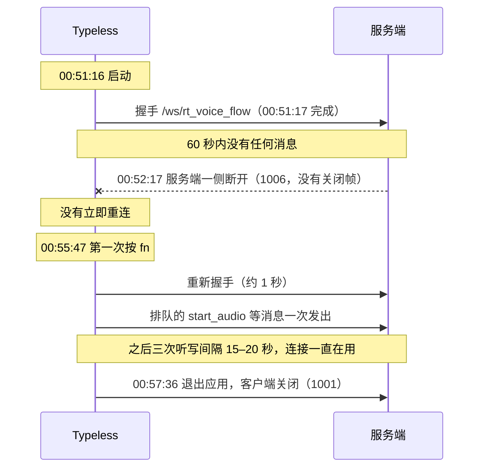
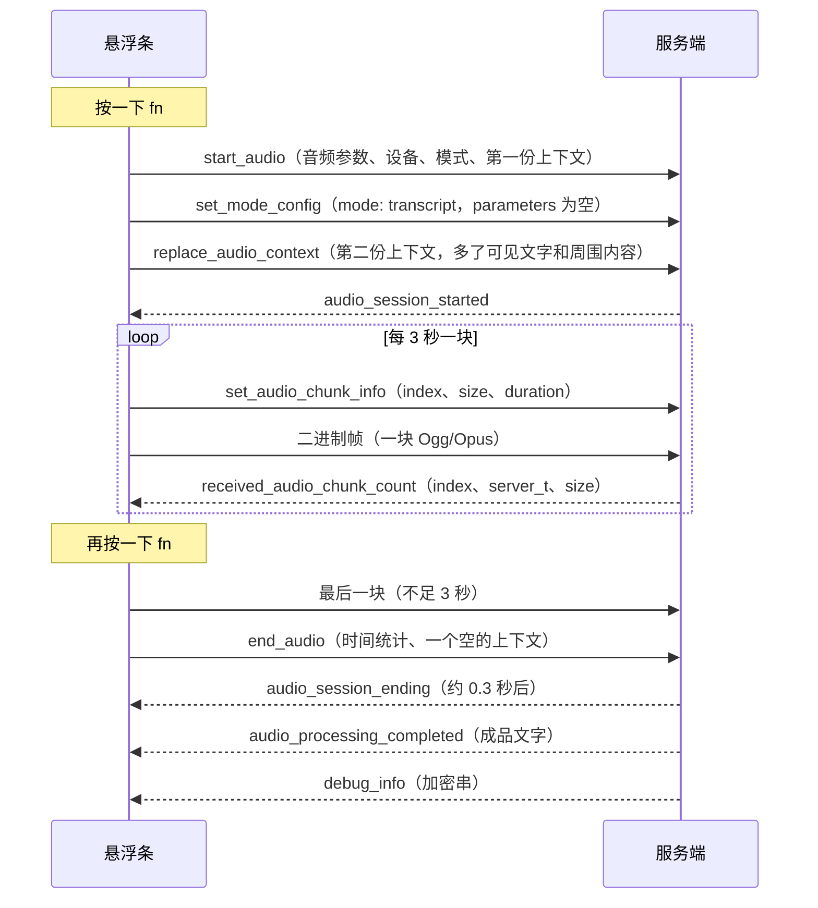

# 09 运行时抓包

状态：**已执行一次**（2026-10-13，4 次普通听写）。方案和操作步骤在前，[结果](#结果)在后。翻译、"问任何事"、修改跟踪、短按、按住这些场景这次没有抓到。

## 为什么常规办法不好用

- 渲染进程的会话设了直连（`setProxy({mode:"direct"})`），系统代理抓不到 WebSocket。
- 主进程用 Node 自带的 `fetch`，不认系统钥匙串里的证书，装了抓包证书也会校验失败。
- 签名开了 hardened runtime 且没有调试权限，不能注入，不能挂调试器。
- asar 有完整性校验，不能改包。

## 用它自己留的开关

`app-settings.json` 里的 `__DEV_API_HOST`（[03](03-process-architecture.md#开发者留下的开关)）：设成一个不含 `typeless.com` 的主机后，主进程和渲染层的 HTTP、WebSocket 都改连它，并且用明文协议。签名和鉴权中间件对任何主机都照常生效。

于是：

```
Typeless ──明文 http/ws──▶ 127.0.0.1:8787（本机 mitmdump，reverse 模式）──TLS──▶ api.typeless.com
```

不用装证书，不用改系统设置，也不动安装包。

### 上下文是密文的问题

`audio_context` 在客户端里就被 RSA 信封加密了，抓到的也是密文。可选的解法（`--decrypt-context`）：

1. 代理把 `/user/get_user_info` 回包里的 `rsa_public_key` 换成本机临时生成的公钥，同时记下真实公钥。
2. 客户端于是用我们的公钥加密上下文。
3. 代理收到后用临时私钥解开，把明文存盘，再用真实公钥按同样格式重新加密，转发给服务端。

服务端收到的内容与正常情况等价（JSON 的空白和键序可能不同）。临时私钥只在代理进程的内存里。同一种信封也用在统计事件上，所以 `/app/metrics_mp` 的内容会一并解出。

副作用：抓包期间新产生的那几条历史记录，本机数据库里存的上下文是用临时公钥加密的，以后谁也解不开（原本你自己也解不开）。云同步没开，不影响别的。

开始前要确认历史迁移已经做完（`app-onboarding.json` 里的 `__HISTORY_V2_MIGRATION_COMPLETED_AT_BY_USER` 有当前用户的条目）。迁移任务也会取这把公钥来重新加密旧记录（[08](08-local-data.md)），没做完就换公钥，旧记录会被临时公钥加密。本机的迁移在 2026-06-02 已完成。

## 操作步骤

```bash
cd targets/typeless

# 终端 A：起代理（一直开着）
tools/capture.sh start --decrypt-context

# 终端 B
osascript -e 'tell application "Typeless" to quit'   # 或菜单栏图标 → Quit
tools/capture.sh on          # 写入开关
open -a Typeless             # 确认悬浮条正常，然后做下面的场景
osascript -e 'tell application "Typeless" to quit'
tools/capture.sh off         # 移除开关
open -a Typeless             # 恢复正常使用；回到终端 A 按 Ctrl-C 停代理

tools/capture.sh har _work/capture/<时间>            # 导出给 REA 用的 HAR
```

`on` / `off` 会检查 Typeless 是否在运行，在运行就拒绝执行：它运行时会回写设置文件，把改动冲掉。

代理停掉而开关还开着时，Typeless 连不上服务端。恢复方法就是上面的 `off` 那三行。

### 交给 REA

REA 的 `inspect_web_network_capture` 读 mitmproxy 原生格式需要 Linux，读 HAR 不需要。`tools/capture.sh har` 用 mitmdump 把 `flows.mitm` 转成 HAR，并把 `Authorization`、`X-Authorization`、Cookie 和 WebSocket 握手里的 `t` 参数替换成长度占位，得到 `capture.har`。

### 建议的场景

每个场景说一两句就行，中间停几秒，方便事后按时间对上。最后一列是 2026-10-13 那次有没有做。

| # | 场景 | 想验证什么 | 已做 |
| --- | --- | --- | --- |
| 1 | 备忘录里空白处，说一句短的中文 | 基线：消息序列、各阶段耗时 | 否 |
| 2 | 备忘录里已有几行文字，光标放中间，说一句 | 光标前后文字是否都被带上 | 否 |
| 3 | 说一段 30 秒以上的长句，中间自我纠正一次（"周三，不对，周四"） | 多个音频块、清洗效果、延时公式的第二档 | 部分：12.8 秒，没有改口 |
| 4 | 中英文混着说一句 | 语言处理 | 否 |
| 5 | Chrome 里随便一个网页的输入框 | 网址、标题、可见文字 | 是，但焦点信息没取到 |
| 6 | 微信的聊天输入框 | 黑名单到底挡了哪些字段 | 是，但输入框没取到 |
| 7 | 终端、Cursor 或 VS Code 里 | 代码类应用的上下文 | 是（iTerm2） |
| 8 | 选中一段文字，用"问任何事"（Fn+Space）说"翻译成英文" | `selected_text`、`set_mode_config` | 否 |
| 9 | 翻译模式（Fn+左 Shift）说一句 | `output_language` | 否 |
| 10 | 听写后，手动改掉结果里的一个词，等 15 秒以上 | `/user/traits` 上报的内容 | 否 |
| 11 | 按一下快捷键，不到半秒再按一下 | 短录音的处理 | 否 |
| 12 | 按住听写键 2 秒再松开（不要说话） | 静态结论"不支持按住说话"是否成立（[10](10-interaction-state-machine.md)） | 否 |
| 13 | 不选中任何文字，用"问任何事"说"帮我搜一下今天的天气" | `delivery` 的取值，`external_action`、`web_metadata` 的实际内容（[14](14-result-delivery.md)） | 否 |
| 14 | 说到一半按 Esc 取消 | 取消时发不发消息，已上传的音频怎么处理 | 否 |

另外抓到一次飞书聊天输入框里的听写，不在原计划里。

## 输出

`_work/capture/<时间>/`（不进仓库）：

| 文件 | 内容 |
| --- | --- |
| `flows.mitm` | mitmproxy 原生抓包，含完整令牌和签名头 |
| `http.jsonl` | 每个 HTTP 往返一行；`Authorization`、`X-Authorization`、Cookie 只留长度 |
| `ws.jsonl` | 每条 WebSocket 消息一行；二进制帧只记长度和前 8 字节 |
| `context/NNN.json` | 解出的信封明文（上下文和统计事件） |
| `raw.har` | `har` 子命令的中间产物，含完整凭据 |
| `capture.har` | 隐去凭据后的 HAR，交给 REA |

这些文件里有你说的话和当时屏幕上的文字，只留在本机。

## 备选方案

开关方案这次可用，下面两条没有用到，留作以后观察渲染进程内部状态的办法：

- **调试端口**：fuses 允许 `--inspect` 和 `--remote-debugging-port`。带参数启动后，REA 的 `list_electron_targets`、`capture_electron_scenario` 可以被动观察渲染进程；REA 的被动观察不记录请求体和凭据，要看内容得另接 CDP 的 Network 域。渲染层的 `window.ipcRenderer.invoke` 没有白名单，也可以直接调 `audio-context:get-audio-context` 看加密前的上下文。
- **只看明文上下文**：单用上一条的 IPC 探测就够，不需要任何网络拦截。

## 结果

一次抓包，2026-10-13 00:51–00:57（本机时间），`_work/capture/20261013-005104/`。REA 记录：`ev_eff73fa79df7…`、`ev_17870b08e45f…`（`capture.har`，sha256 `2651eefbb7be…`，18 条记录）。经 REA 逐条读的是其中 5 条 HTTP 记录；WebSocket 那条记录有 55 万字节，消息内容是从同一次抓包的 `ws.jsonl` 读的。

下面的数字都只有 4 个样本，而且都是 13 秒以内的普通听写。

### 开关和代理可用

- 设了开关后，启动阶段的 14 个 HTTP 请求全部 200，WebSocket 握手 101，登录态没掉。
- 整个过程 16 个 HTTP 往返、2 次 WebSocket 握手，没有出现 418，也没有任何非 200 的状态码。服务端没有因为连接来自 mitmproxy 而拒绝。[05](05-network-protocol.md#请求签名) 里那条 TLS 指纹校验的推断，这次没有被触发。
- 服务端地址在本机解析成 `198.18.0.x`（保留网段），说明本机有代理类软件接管了出站流量。下面的耗时都含这一段，也含 mitmdump 这一跳。

### 启动时的请求

Typeless 启动后一秒内发出：

| 来源 | 请求 |
| --- | --- |
| 主进程 | `POST /app/get_blacklist_domain`、`POST /transcription_history/sync_status` |
| 渲染层 | `GET /user/get_user_info` ×2、`GET /user/get_dictation_settings` ×2、`POST /user/personal_stats` ×2、`POST /user/usage_stats` ×2、`POST /user/insights` ×2、`POST /app/get_free_quota_notice_banner_config` ×2 |
| 渲染层 | `GET /ws/rt_voice_flow`（升级为 WebSocket） |

渲染层的请求成对出现，推断是两个窗口各发一遍。主进程和渲染层的请求从请求头就能分开：主进程的 `user-agent` 是 `node`，带 Sentry 的 `sentry-trace` 和 `baggage` 头；渲染层的是 Chromium 的完整请求头。

### 语音通道不是常连的



- 启动时就预先连上，但空闲满 60 秒被服务端一侧断开。抓包记录里这次关闭不是客户端发起的（`closed_by_client = false`），握手完成到断开相差 59.98 秒。是服务端还是它前面的负载均衡断的，分不出来；直连官方时是否同样如此，没有验证。
- 断开后客户端不立即重连，等下一次按键。代码里发消息前发现没连上会先连，消息进队列，连上后补发（readable:UfR9-a2Z.js:10939-11009）。
- 代价：隔了一段时间后的第一次听写，`start_audio` 在按下 1158 ms 后才发出去，其余三次是 103–184 ms。录音本身不受影响，按下到拿到第一个音频采样只有 87–97 ms（`end_audio` 里的 `record_pressed_to_first_audio_sample_latency_ms`）。
- 第二条连接存活的 108 秒里一共 59 条消息，全部属于那 4 次听写，没有 `ping`。代码里 `ping`、`pong` 只出现在消息类型的枚举里，没有发送它的地方（可读树全量字面量搜索）。

[10](10-interaction-state-machine.md#时间参数) 里客户端自己有一个"空闲 1 小时主动断开"的定时器。这次看到的那一次空闲（启动后还没用过）60 秒就被服务端断了，比它早得多。用过之后的空闲是不是也 60 秒断，这次没有观察到：几次听写之间最长只隔了 29 秒。

握手请求不带 `Authorization`，令牌和签名都在查询参数 `t` 里（576 个字符，Base64 后以 `U2FsdGVkX1` 开头，即 [05](05-network-protocol.md#连接) 说的口令式 AES 格式）。`Origin` 是 `file://`。客户端提出了 `permessage-deflate`，服务端的回应里没有接受，所以消息不压缩。

### 一次听写的消息序列

4 次的顺序完全一致，只是音频块的数量不同：



各消息的完整字段写在 [05](05-network-protocol.md#websocketwsrt_voice_flow)。几个要点：

- **第一份上下文随 `start_audio` 一起发**，不是单独发。第二份用 `replace_audio_context` 整份替换，后三次分别晚 50、114、247 ms（第一次因为重连排队，两条几乎同时发出）。
- **默认的听写模式也发 `set_mode_config`**，内容是 `{mode: "transcript", parameters: {}}`。
- **每一块都是独立的 Ogg 流**。每个二进制帧都以 `OggS` 加流起始标记开头，服务端不需要等前一块就能解码。3 秒的整块有 5 个，大小 13.8–15.0 KB，折合 37–40 kbps，比标称的 32 kbps 高。
- **录音过程中服务端不回识别文字**。4 次都没有出现 `transcription` 消息，服务端对每一块只回一个收到确认。成品在 `end_audio` 之后一次给出。
- **`end_audio` 里的上下文是空对象**（加密后发），不是结束时再采一次。
- **成品消息**的 `V` 是 `{audio_id, refined_text, status, run_index, web_metadata, delivery, action, user_prompt, external_action}`。听写时后五项全是 `null`，`status` 为 `true`，`run_index` 为 1。
- 服务端消息的外壳是 `{K, V, T, M, S}`：`K` 是类型，`V` 是内容；`T` 这次全是 `"json"`，`M` 全是 `false`，`S` 全是 `"done"`，后三个的其他取值没见到。

4 次都是 WebSocket 给出的结果，没有出现 `POST /ai/voice_flow`。成品都在 2 秒内回来，离兜底请求的启动延时（6.5 秒）很远。

### 耗时

| # | 应用 | 录音时长 | 音频块 | 按下到 `start_audio` 发出 | `end_audio` 到成品 | 成品字数 |
| --- | --- | --- | --- | --- | --- | --- |
| 1 | Chrome | 2.6 秒 | 1 | 1158 ms（先重连） | 1454 ms | 8 |
| 2 | 微信 | 2.5 秒 | 1 | 176 ms | 1447 ms | 8 |
| 3 | iTerm2 | 12.8 秒 | 5 | 184 ms | 1925 ms | 30 |
| 4 | 飞书 | 4.3 秒 | 2 | 103 ms | 1523 ms | 10 |

其他阶段：`start_audio` 到服务端确认会话开始 256–323 ms；`end_audio` 到 `audio_session_ending` 279–398 ms；`debug_info` 在成品之后 27–331 ms 到。

`audio_session_ending` 里有 `total_chunks`、`completed_chunks`、`failed_chunks`、`process_delay` 等字段。5 块的那次 `total_chunks` 也是 1，所以它数的不是上传的块，推断是服务端合并后的处理单元。

**延时公式**（[14](14-result-delivery.md#成品里的时间参数)）：`start_audio` 里的 `taking_longer_alert_delay_ms` 是 6000，`end_audio` 里 4 次都是 6500，与"6000 加每 30 秒 500"在第一档的结果一致，时长的单位是秒。4 次都不到 30 秒，第二档没有覆盖到。

### 上下文的明文

每次听写解出三份：`start_audio` 带的、`replace_audio_context` 带的、`end_audio` 带的（空对象）。下表是第二份，也就是服务端最终拿到的那份。只列结构和长度，不记内容。

| # | 应用 | 命中黑名单 | 应用与窗口 | 输入框 | 光标文字 | 可见文字 | 周围内容 | 明文大小 |
| --- | --- | --- | --- | --- | --- | --- | --- | --- |
| 1 | Chrome | 否 | 只有应用名、包名、进程号；窗口、网址、标题都是空 | 没取到，`is_editable: false` | 空 | 试了，结果为空 | 没有采 | 2.0 KB |
| 2 | 微信 | 是 | 同上，窗口信息为空 | 没取到，`is_editable: false` | 试了，失败 | 没有采 | 没有采 | 1.8 KB |
| 3 | iTerm2 | 否 | 完整 | `AXTextArea`，可编辑 | 光标前 5000（截断）、后 199、整框 5199 | 10003（截断） | 后 985 | 55.7 KB |
| 4 | 飞书 | 否 | 完整 | `AXTextArea`，可编辑，带 6 个 DOM class | 失败 | 3741 | 前 541、后 44 | 6.7 KB |

- **字段结构与 [06](06-context-capture-and-privacy.md#上下文的完整结构) 的静态结论一致**，`device_environment` 的字段这次补全了，写在那一篇里。
- **`context_metadata.context_quality` 记了每一步的成败**：`app_window`、`visible_text`、`input_element`、`cursor_input`、`surrounding_context` 各有状态、耗时、是否超时、是否截断，失败时带错误码。上表的"没取到""失败"就是从这里读的。
- **Chrome 和微信两次都没取到焦点**，错误码是 `no_focused_application` 和 `no_focused_element`。原因没有查清：可能是这两个应用的辅助功能树本来就难读，也可能与 Typeless 刚重启有关。两次的文字都正常贴进去了。
- **黑名单的效果看到了一半**。微信那次 `is_text_capture_blocked_by_blacklist` 为 `true`，质量记录里没有 `visible_text` 和 `surrounding_context` 两项（即没有去采），而 `cursor_input` 有记录（去采了，因为没有焦点元素而失败）。这与"黑名单只挡可见文字和周围内容，不挡光标文字"的静态结论一致。但因为那次焦点元素没取到，"光标文字在微信里真的会发出去"这一点仍然没有直接看到。
- **在终端里听写，发出去的最多**。终端的整个文字区是一个 `AXTextArea`，于是"输入框全文"就是终端最近的输出：光标前 5000 字符、整框 5199 字符，再加 10000 字符的可见文字和 985 字符的周围内容。iTerm2 不在 macOS 的黑名单里（Windows 的黑名单有终端，见 [06](06-context-capture-and-privacy.md#黑名单)）。终端里如果刚打印过密钥或内部数据，会随听写一起上传。
- **飞书**取光标文字失败（`unsupported_accessibility_operation`），但可见文字和输入框前后的内容都取到了，也就是聊天窗口里别人的消息会被采。

`capture_frequency` 里有三个计数：`app_focus_count` 和 `input_field_focus_count` 每次在 4 到 210 之间，`system_info_refresh_count` 一直是 0。含义没有查。

### 统计上报

`POST /app/metrics_mp` 只出现 2 次，请求体是 `{info: 信封}`，用的是和上下文同一种 RSA 信封。解出的两条都是同一个事件：

```
event_key: error_monitoring_undetectable_textbox_found
data: environment, event_source, typeless_app_version, locale, appName, appBundleId, webDomain
```

分别对应 Chrome 和微信那两次（输入框没取到）。也就是说检测不到输入框时，它会把当时的应用名、包名和网页域名报上去。另外两次正常的听写在抓包窗口内没有产生统计请求。

### 与本机历史库对照

抓到的 4 个 `audio_id` 就是 `history_v2` 里最新的 4 行：

| 对照项 | 结果 |
| --- | --- |
| 成品文字与 `audio_processing_completed` 的 `refined_text` | 4/4 相同 |
| 库里的 `audio_context` | 4/4 是第二份上下文的信封（`_data` 长度相同） |
| 库里的 `debug_info` | 4/4 是 `debug_info` 消息的整个 `V` 对象，内层字符串长度相同 |
| 库里的 `client_metadata` | 4/4 是 `end_audio` 里那份（延时 6500） |
| 录音文件 | 4/4 存在，`.ogg`，大小是上传各块之和的 82%–86% |

本机录音比上传的块小，推断是每块独立编码有固定开销，没有细查。

`debug_info` 的内层字符串以 `U2FsdGVkX1` 开头，与本机数据库里的历史样本一样（[08](08-local-data.md)）。内容未知，这次没有去解。4 次的长度依次是 17、20、88、47 KB，对应的上下文明文是 2.0、1.8、55.7、6.7 KB：上下文大的两次它也大，但不成比例。

### 被纠正的静态结论

| 原来的说法 | 实际 | 改在哪 |
| --- | --- | --- |
| 语音通道是常驻长连接，有 `ping`/`pong` 保活 | 没有保活，空闲 60 秒被服务端断开，按键时重连 | [05](05-network-protocol.md#连接)、[00](00-overview.md) |
| 服务端逐块回识别文字（`transcription`） | 听写时没有，只回收到确认 | [04](04-voice-pipeline.md)、[05](05-network-protocol.md) |
| 成品消息是 `refine_completed` | 听写时是 `audio_processing_completed` | [04](04-voice-pipeline.md)、[05](05-network-protocol.md) |
| 非默认模式才发 `set_mode_config` | 默认模式也发 | [04](04-voice-pipeline.md) |
| `GET /app/get_blacklist_domain` | 是 `POST`，回包的 `data` 是一个加密字符串 | [05](05-network-protocol.md) |
| 统计事件用写死口令的 AES 加密 | 拿到公钥时用 RSA 信封，写死口令是取不到公钥时的退路 | [05](05-network-protocol.md) |

### 这次没有回答的

- 翻译和"问任何事"的消息（`set_mode_config` 的参数、`delivery` 的实际取值、`set_selected_text`）。
- `/user/traits`：4 次听写之后都没有手动改字，没有触发。
- 按住、短按、Esc 取消时发不发消息。
- 30 秒以上的长录音：延时公式的第二档、弱网降级、HTTP 兜底。
- Chrome 和微信取不到焦点的原因。
- 清洗做了什么：服务端不回原始识别文字，客户端这一侧看不到"清洗前"。

这些都记在 [91](91-open-questions.md)。
