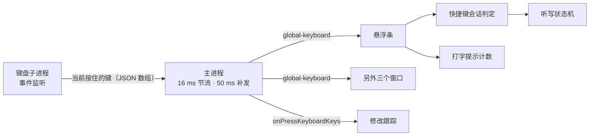
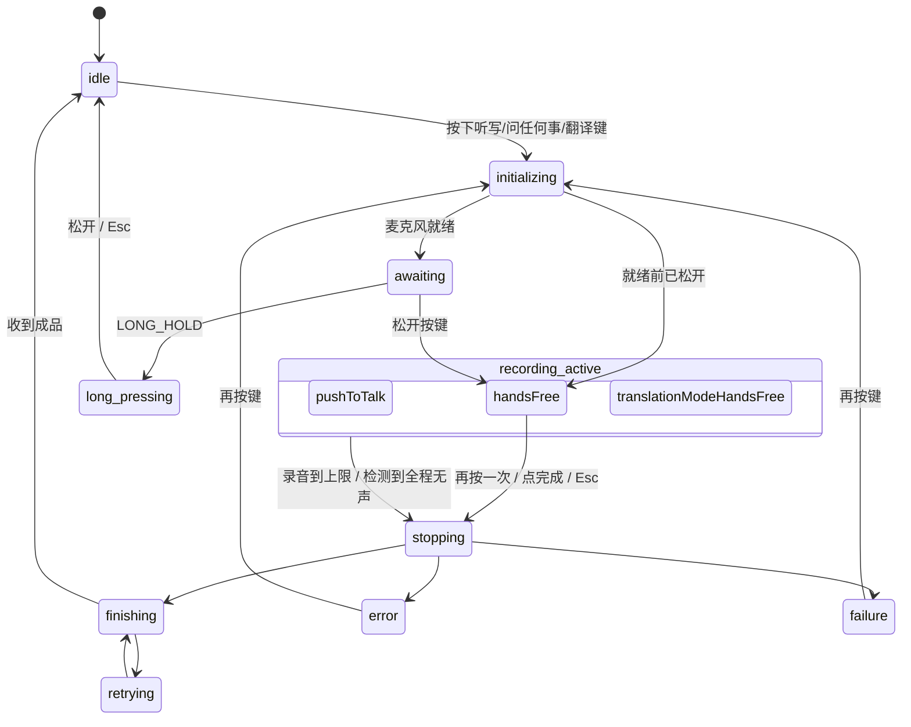

# 10 交互状态机与按键

悬浮条渲染进程里的 XState 状态机（readable:qA149QP2.mjs:6101-7400）和按键事件的流向。静态阅读的结论。

## 按键事件怎么走

- 原生层每次按键状态变化都回调一次，内容是**当前按住的全部键**：`[{keyCode, keyName, enKeyName}]`（readable:main/index.js:11833-11880）。不只是快捷键，普通字母键也在里面。
- 主进程把这份状态广播给四个窗口（通道 `global-keyboard`，readable:main/index.js:12754-12764）。
- 已确认的三个消费者：
  1. **快捷键判定**：悬浮条里一个 reducer 把按键变化转成 `PRIMARY_KEY.DOWN`、`HANDSFREE_KEY.UP` 这类事件喂给状态机。
  2. **修改跟踪**：见 [06](06-context-capture-and-privacy.md#插入后的修改跟踪)。它用一个固定集合（字母、数字、标点、回车、Tab、空格、删除）判断"用户在编辑"（readable:main/index.js:17221）。
  3. **打字提示计数**：见下。
- 设置页里录制快捷键的控件也订阅这个通道（CeQePRHT.js:31869）。
- 主界面大包里的那处订阅（readable:DNMdpbnK.mjs:53654-53686）是**排障向导第 3 步“快捷键检测”**：让你按一下听写键，看能不能收到。测试期间保留最近 30 条按键事件（键名、按下/松开、时间）。向导数据打包时先过一个脱敏函数，把这份按键记录删掉，同时删掉的还有麦克风设备名、听写日志和测试时的识别结果（readable:DNMdpbnK.mjs:7538-7590）。打包后的数据发往哪里没有读。
- 在这几处都没有看到把按键内容写盘或上传的代码。

### 打字提示计数

悬浮条里有个小类（readable:qA149QP2.mjs:7860-7960）：当焦点在可编辑输入框里时，把你敲的可打印键（字母、数字、标点、空格）按 `{时间, 应用, 键名}` 记进一个队列，只保留最近 60 秒。队列超过 60 个就触发一次提示并清空，换应用也清空。推断提示内容是"你在打很多字，试试语音"。

也就是说它知道你最近一分钟敲了哪些键，但只用来数数，数据留在渲染进程内存里。

## 状态

图里的 `initializing` 实际是三个状态（`initializingForTapOrHold` / `ForHandsFree` / `ForTranslation`），`awaiting` 是 `awaiting_long_press_or_tap`。

要点：

- **按下就开始录**。进入 `initializing*` 的入口动作里就有 `startRecording`，不等判定是点按还是长按。
- **松开进入免提录音**：`awaiting_long_press_or_tap` 里收到按键抬起，转到 `recording_active.handsFree`，之后再按一次任意功能键结束。
- **`long_pressing` 的入口动作是"提示不要按住、只需按一下"、停止录音、清掉本次的音频编号**（`showDoNotHoldJustPressAlertAction`、`stopRecording`、`WEBSOCKET.CLEAR_AUDIO_ID`，readable:qA149QP2.mjs:7018-7037）。之后松开按键回到 `idle`，这次录音作废。
- **2.8.1 不支持"按住说话"**，见下一节。
- `recording_active` 期间：每 100 ms 一个 tick 检查有没有该发的音频块；进入 1 秒后开始音量检测，判定全程无声则以"未检测到语音"结束。
- `finishing` 等成品，有超时定时器。

## "按住说话"在这一版里不存在

结论：按住听写键超过 600 ms，录音被取消并提示"不要按住，按一下就行"。只有"按一下开始、再按一下结束"这一种用法。静态结论，建议抓包时顺手按住试一次（[09](09-runtime-capture.md) 场景 12）。

依据有三条：

1. **`LONG_HOLD` 的发出条件**（快捷键会话 reducer，readable:qA149QP2.mjs:7390-7525）。命中快捷键时建立一个会话并启动 600 ms 定时器；按键全部松开会结束会话，定时器随之取消。定时器到点时会话还在，就发 `longHold`，并把会话标成"等待松开"，之后的按键变化一律忽略，直到松开。所以 `longHold` 的含义就是"按下后 600 ms 还没松"。
2. **状态机对它的处理**（readable:qA149QP2.mjs:6972-6976）。只有 `awaiting_long_press_or_tap` 接 `LONG_HOLD`，目标是 `long_pressing`，也就是上面说的取消加提示。
3. **`pushToTalk` 子状态没有入边**。它是 `recording_active` 的初始子状态（7039），但全文件进入 `recording_active` 的 6 处转移都显式写了子状态：4 处 `handsFree`、2 处 `translationModeHandsFree`（6862、6913、6949、6996、7002、7008）。没有一处指向不带子状态的 `recording_active`，所以初始子状态永远用不上。

`pushToTalk` 是旧版留下的代码。主进程的设置迁移里能看到来历（readable:main/index.js:20627-20628）：旧设置项 `pushToTalk` 改名成了 `dictationMode`，`handlesFreeMode` 改名成了 `askAnythingMode`。也就是说早期版本的听写键是"按住说话"，另一个键是"免提"；现在两个键都是免提，状态机里的事件名 `PRIMARY_KEY` / `HANDSFREE_KEY` 是那时的叫法。

一个边界情况：麦克风初始化期间（`initializingFor*`）不接 `LONG_HOLD`。如果初始化本身超过 600 ms，`longHold` 会被丢掉，之后松开按键照常进入免提录音。推断这是有意的——不因为设备慢而误判用户在长按。

### 快捷键会话的其他规则

同一段 reducer 里还有：

- 会话进行中又命中一个快捷键（比如先按住 `Fn` 再加 `Space`），只接受一次"升级"，功能切到新命中的那个；第三次起忽略。
- 会话进行中按了不属于任何候选快捷键的键，发 `wrongKeyDown`，状态机取消本次录音回到 `idle`。这是"按着 Fn 又去按别的键"时不误触发的原因。
- 听写键两次按下间隔不到 300 ms 的，第二次忽略（7551、7757-7763）。

## 时间参数

| 参数 | 值 | 位置 |
| --- | --- | --- |
| 长按判定 | 600 ms | `LONG_PRESS_MS`，qA149QP2.mjs:6102 |
| 双击窗口 | 400 ms | `DOUBLE_CLICK_MS`，6101 |
| 等成品超时（听写） | 20 秒 | `VOICE_TRANSCRIPT_REFINE_TIMEOUT_MS`，6103 |
| 等成品超时（问任何事） | 30 秒 | `VOICE_COMMAND_REFINE_TIMEOUT_MS`，6104 |
| 单次录音上限 | 9 分钟，最后 1 分钟倒计时 | `MAX_DURATION_MS: 540000`、`COUNTDOWN_BUFFER_MS: 60000`，4191 |
| 音频分块 | 3000 ms | 4546；可用 localStorage `debug_audio_chunk_interval` 覆盖 |
| 发送检查间隔 | 100 ms | `socketTickTimer`，6193 |
| WebSocket 空闲断开 | 1 小时 | `socketIdleTimer`，6181。这是客户端自己的定时器；抓包看到服务端在连接空闲 60 秒时就先断了（[09](09-runtime-capture.md#语音通道不是常连的)） |
| HTTP 兜底延时 | 6000 ms + 每 30 秒录音 500 ms + 每 1000 字选中文字 500 ms。抓包里 4 次不到 30 秒的听写都是 6500，时长单位是秒 | qA149QP2.mjs:5422-5429，基数在 UfR9-a2Z.js:10457。作为 `taking_longer_alert_delay_ms` 随消息发给服务端 |
| 听写键防抖 | 300 ms | qA149QP2.mjs:7551 |
| HTTP 兜底超时 | 40 秒 | main/index.js:17905 |
| 按键广播节流 | 16 ms，另有 50 ms 周期补发 | main/index.js:12699-12701 |
| 修改跟踪 | 15 秒无编辑则结束 | main/index.js:17224 |
| 焦点轮询 | 1000 ms | main/index.js:11352 |

## 默认快捷键（本机设置）

| 功能 | 按键 |
| --- | --- |
| 听写 | `Fn` 或右 `Cmd` |
| 问任何事 | `Fn+Space` |
| 翻译 | `Fn+左Shift` |
| 再贴一次上一条 | `Ctrl+Cmd+V` |

前三个下发给原生层做监听目标；"再贴一次"不走原生监听（readable:main/index.js:12798-12812 里把它排除了），推断用的是 Electron 的全局快捷键。

## 统计事件

用字面量搜索在主进程和主要渲染层文件里找到 13 个事件名，经 `/app/metrics_mp` 上报：

- 错误类 10 个：`error_monitoring_` 前缀，包括 Opus 压缩失败、粘贴失败、上下文库初始化失败、RSA 加密失败、音频块积压、语音接口异常、更新失败、重试发起失败、旧表迁移出错、**检测不到输入框**。
- 性能类 2 个：录音初始化耗时、键盘监听重启。
- 点击类 1 个：分享洞察。

其中 `error_monitoring_undetectable_textbox_found` 带的属性有应用名、bundle id、**网页完整网址**和域名：当你在某个页面按了听写但它认不出输入框时，这个页面的网址会被上报一次（同一应用加网址只报一次，readable:main/index.js:11566-11578）。

事件名如果是变量拼出来的，这种搜法找不到，所以 13 是下限。
