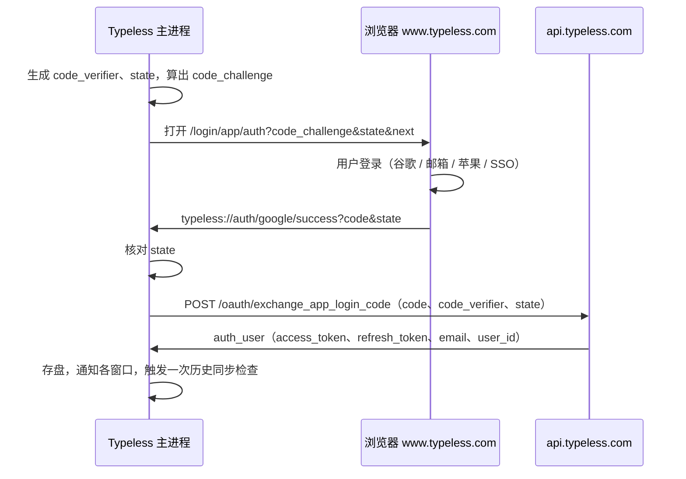

# 12 账号与登录

登录走系统浏览器加自定义协议回调，令牌存在本地一个"加密"文件里。静态阅读的结论，登录过程没有实际跑过。

## 登录流程



这是标准的 PKCE 授权码流程（readable:main/index.js:10001-10096、14027-14118）：

- `code_verifier` 是两个随机 ID 拼起来的字符串，`code_challenge` 是它的 SHA-256 再做 base64url。`state` 是另一个随机 ID。三者只放在内存里的 `pendingAppLogin`。
- 登录页地址是 `https://www.typeless.com/login/app/auth`，参数 `next` 决定落到哪种登录方式：`/login/google`、`/login/email`、`/login/apple`、`/login/sso`、`/login`。
- 回调地址的路径固定是 `/google/success`，不管实际用的是哪种登录方式。macOS 上由 `open-url` 事件接收，Windows 上由 `second-instance` 事件从命令行参数里找。
- 换令牌的请求不带登录态（显式关掉了鉴权中间件），因为这时还没有令牌。
- 失败码：1101 回调缺 `code` 或 `state`，1102 本地没有待完成的登录，1103 `state` 对不上，1104 存盘失败。

另一个协议回调是 `typeless://price/plan/success`（付费成功），只做一件事：通知窗口刷新用户角色。

顺带看到一处没生效的代码（14098）：回调处理函数被包了一层 1 秒节流，但包完的结果没有赋给任何变量，实际注册的还是原函数。短时间内连续收到两次回调时，第二次会因为待完成的登录已被第一次取走而得到 1102；界面上怎么表现没有验证。

端点表里还有四个旧接口（`/oauth/signin_with_google`、`auth_user_from_google`、`signin_with_email`、`verify_secret_code`），调用方没有追。

## 令牌

| 项 | 做法 | 位置 |
| --- | --- | --- |
| 访问令牌 | JWT，读其中的 `exp` 判断过期 | 9802-9807 |
| 提前刷新 | 距过期不到 10 分钟就刷新 | 9814 |
| 刷新请求 | `POST /oauth/refresh_access_token`，`Authorization: Bearer <刷新令牌>`，参数 `app=typeless_webapp` | 9847-9859 |
| 并发 | 同时多处要令牌时共用一个进行中的刷新 | 9826-9835 |
| 刷新令牌失效 | 距过期不到 1 分钟，或服务端回 401，判为 `auth_fatal`，拿不到令牌 | 9842、9860 |
| 退出登录 | `POST /oauth/logout` 带刷新令牌，不等结果；本地清空 | 9897-9953 |

判断过期用的不是本机时间，是"本机时间加一个偏移量"（3260-3277）。偏移量由 `setAPIFetchTimeDiffByServerTime` 用服务端时间校出来，存在本地。这样本机时钟不准时不会误判过期。什么时候校准没有追。

切换账号时（新登录的 `user_id` 与本地不同）会先调一个清理函数再保存新用户（9918-9921）；清理了哪些东西没有读。

## 本地存储：加密是摆设

`~/Library/Application Support/Typeless/user-data.json` 由 electron-store 写入，开了它的 `encryptionKey` 选项。文件内容是整个用户对象的 JSON：两个令牌、邮箱、用户 ID、登录时间等。

问题在密钥怎么来的（readable:main/index.js:9890-9896）：

```
密钥 = PBKDF2-SHA256( SHA256(操作系统 + "-" + CPU 架构) + 应用名, 固定盐, 10000 轮, 32 字节 )
```

操作系统、架构、应用名、盐，没有一项是秘密，也没有一项因用户或机器而异（同一种机型上所有人的密钥相同）。所以这层加密只防"用文本编辑器打开看一眼"，不防任何能读到这个文件的程序。

在主进程代码里没有搜到 `safeStorage`（Electron 提供的、背后是系统钥匙串的加密接口）。也就是说刷新令牌没有进钥匙串。搜索范围是可读树里的 `main/index.js`，字面量搜索。

代码里还留着上一代密钥的派生函数（盐不同），启动时用它尝试读旧文件、迁移后删除（9986-10000）。

这一节只读了代码，没有去解本机的 `user-data.json`。

## 给仿写的备忘

- 桌面应用登录用"系统浏览器 + PKCE + 自定义协议回调"是现成的好做法，可以照搬。回调里一定要核对 `state`。
- 令牌放系统钥匙串（Electron 用 `safeStorage`，Swift 用 Keychain Services），不要自己派生一个固定密钥。
- 用服务端时间校准本机时钟这一手值得学，签名和过期判断都受益。
