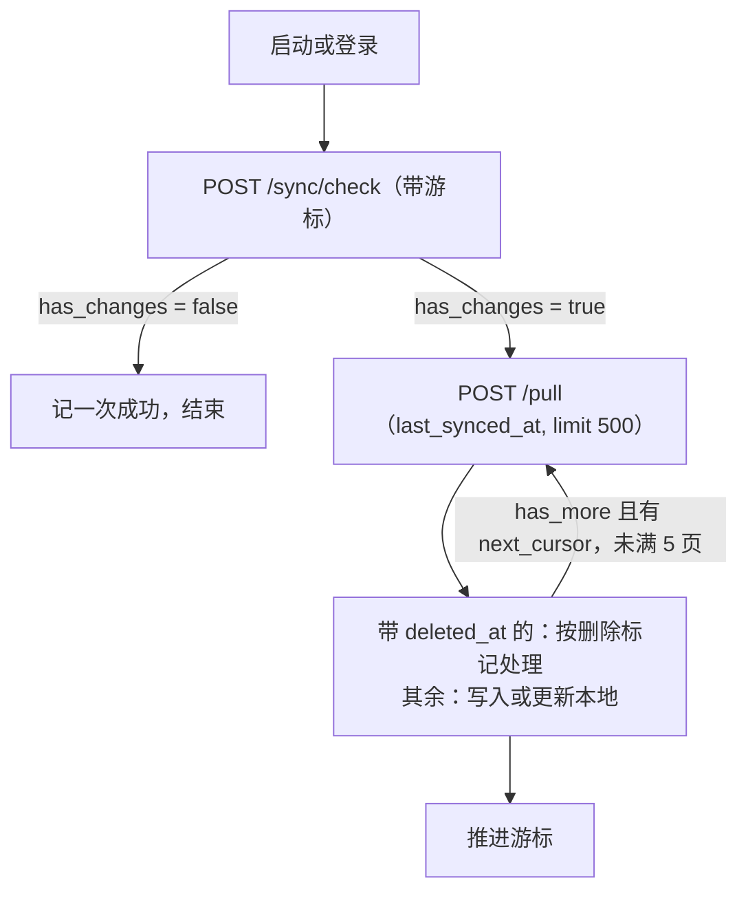

# 13 历史云同步

把听写历史的**文字**同步到云端的可选功能。本机没有开启（[08](08-local-data.md)），所以这一篇全部来自静态阅读，没有任何运行时观察。

## 同步的是什么

推上去的每条记录只有这些字段（readable:main/index.js:8926-8946）：

```
audio_id, user_id, platform("macos"), mode, status, created_at,
duration, app_version, refined_text, mode_meta,
deleted_at, expected_server_updated_at
```

没有录音文件，没有 `audio_context`，没有 `debug_info`。只推"已完成且成品文字非空"的记录，外加"问任何事"里结果是打开外链的那种（8739-8741）。

注意这只说明同步功能不重复上传录音和上下文。听写当时它们已经随请求发给服务端了（[04](04-voice-pipeline.md)、[06](06-context-capture-and-privacy.md)），服务端留不留是另一回事，客户端看不到。

## 结构

两层：一个与业务无关的同步引擎，加一个挂在它上面的"听写历史"任务。

**引擎**（3947-4245）按"频道"管理任务，每个任务声明自己的配置。目前只注册了一个频道：

| 配置 | 听写历史的取值 | 含义 |
| --- | --- | --- |
| `channel` | `transcription_history` | 频道名 |
| `syncCheckTriggers` | `appStarted`、`userLoggedIn` | 哪些事件触发"检查云端有没有新东西" |
| `syncCheckIntervalMs` | 未设置 | 不做定时检查 |
| `defaultIncludeData` | `false` | 检查时不让服务端直接带数据回来 |
| `pushDebounceMs` | 10000 | 本地有改动后等 10 秒再推 |

引擎里有个"会话代数"计数器，`invalidateSession()` 被调用时加一。每个异步步骤结束后都核对代数，对不上就丢弃结果。推断用途是换账号或关闭同步时作废还在路上的请求，防止上一个账号的回包写进下一个账号的数据；哪些地方调用它没有逐个看。

**设置状态**（8166-8376）存在 `transcription-history-sync-state.json`，按用户 ID 分开：是否开启、开启时间、云端保留时长 `retention_seconds`、清理线 `purge_before_at`、是否因套餐或组织策略被动关闭、配额超限警告。

## 协议

全部是 `POST`，走统一的签名和鉴权（[05](05-network-protocol.md)）。

| 接口 | 用途 | 参数要点 |
| --- | --- | --- |
| `/sync/check` | 问云端各频道有没有变化 | `subscriptions: [{channel, updated_at: 游标, include_data}]` |
| `/transcription_history/pull` | 拉取游标之后的变化 | `last_synced_at`、`limit: 500` |
| `/transcription_history/push` | 推送本地记录或删除标记 | `records: [...]`，每批最多 200 条，超时 30 秒 |
| `/transcription_history/load_older` | 往更早翻页，补本地没有的旧记录 | 未展开 |
| `/transcription_history/sync_status` | 取同步设置 | 无 |
| `/transcription_history/sync_settings` | 改设置 | `enabled`、`retention_seconds` |
| `/transcription_history/acknowledge_hints` | 确认提示已读 | 未展开 |
| `/transcription_history/wipe` | 清空云端历史 | 无 |

`/sync/check` 的回包里每个频道有 `has_changes`、`data_shape`、`data`、`has_more`、`next_cursor`。听写历史只认 `data_shape` 为 `record_list` 的情况。

### 拉取



一次最多拉 5 页（8601），也就是 2500 条，剩下的等下一次触发。游标优先用服务端给的 `next_cursor`，没有就用这批记录里最大的 `server_updated_at`（9181-9190）。

### 推送

- 本地每条记录有 `sync_status`：`pending_upload`、`synced`、`sync_failed`。
- 候选是 `pending_upload` 的，加上 `sync_failed` 且失败次数不到 3 的（8600、8729-8738）。
- 按 `(created_at, id)` 倒序分页，每页 200 条（8587）。这是键集分页，不用 `OFFSET`，推送途中有新记录插进来也不会漏或重。
- 如果设置里有清理线，早于它的记录不推。
- 服务端逐条回结果：
  - `accepted`：标为 `synced`，并用服务端给的 `server_created_at`、`server_updated_at` 覆盖本地时间。
  - `server_version_mismatch`：同样标为 `synced`。
  - 其他：标为 `sync_failed`，失败次数加一。

### 冲突怎么处理

每条推送带 `expected_server_updated_at`（本地记着的云端版本）。服务端发现版本对不上就回 `server_version_mismatch`，客户端的反应是把这条当成已同步，不重推（8975-8986）。

所以策略是**云端优先**：本地改动与云端冲突时放弃本地这次推送，等下一次拉取把云端版本拉下来。我的看法是这对听写历史够用：记录生成后几乎不会再改，会冲突的主要是"两台设备都动了同一条"。

### 删除

删除用"墓碑"：推一条 `deleted_at` 有值的记录（9348-9452）。拉取到的墓碑交给 `applyPulledTombstonesToLocal` 处理，推断是删掉本地对应的记录，函数体没有读。清理线 `purge_before_at` 推断是按时间成批失效，对应"只保留最近 N 天"这种设置。

## 企业策略的影响

见 [15](15-update-policy-permissions.md#企业策略)：企业版可以由组织决定成员能不能开云同步，以及历史保留多久。

## 给仿写的备忘

- "引擎加频道任务"的分法对只有一种数据的玩具是过度设计，直接写死一个同步任务即可。
- 值得照搬的三点：键集分页；每条记录带期望版本做乐观并发；用会话代数作废过期的异步结果。
- 推送去抖 10 秒、失败重试上限 3 次、拉取单次封顶 5 页，这三个数可以直接用。
