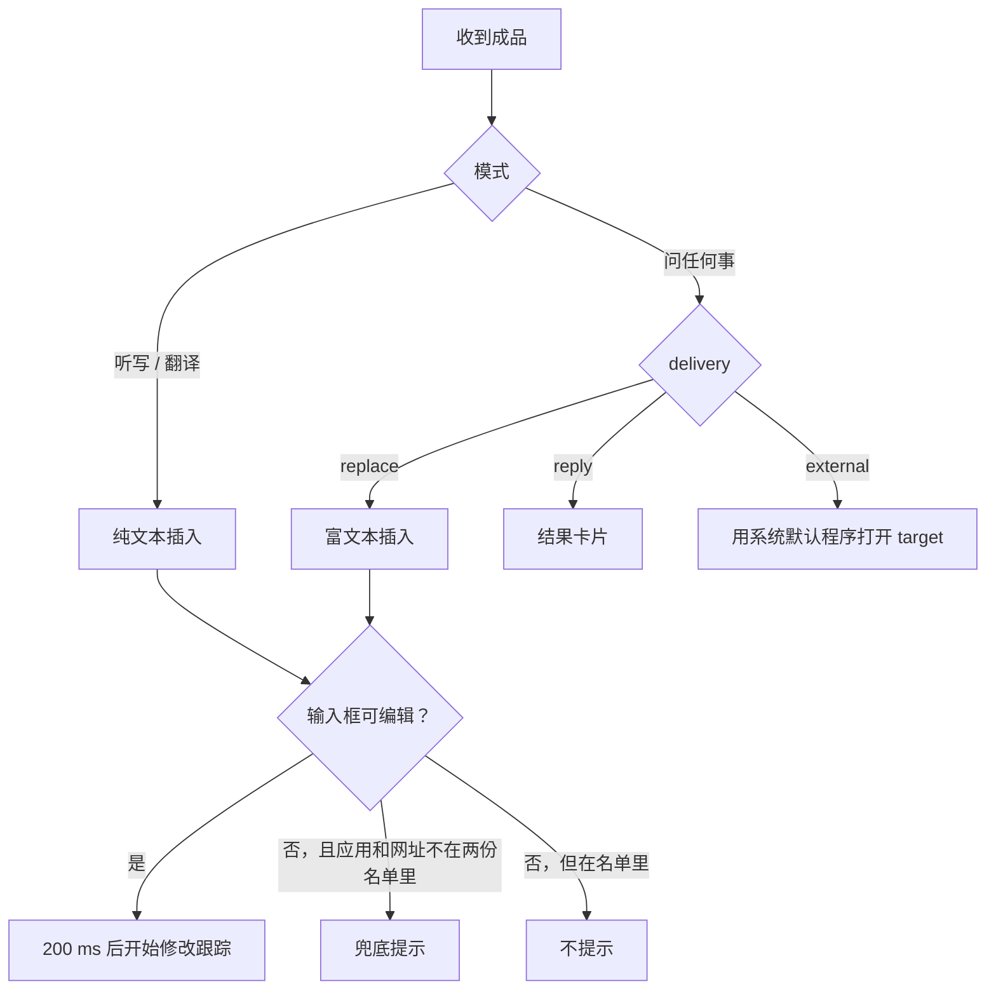

# 14 结果投递

服务端的成品回来之后，客户端怎么把它交到你手上。静态阅读的结论。结果卡片窗口内部没有读。

## 成品里有什么

HTTP 兜底的回包里读这几个字段（readable:main/index.js:17919-17927）；悬浮条对成品做归一化时读的也是同一组（readable:qA149QP2.mjs:5414-5421）。抓包确认了 WebSocket 的完成消息带的是同一组（[09](09-runtime-capture.md#一次听写的消息序列)）：`audio_processing_completed` 的内容是 `{audio_id, refined_text, status, run_index, web_metadata, delivery, action, user_prompt, external_action}`。抓到的 4 次都是普通听写，`delivery` 等几项全是 `null`，所以 `delivery` 的三个取值仍然只来自代码。

| 字段 | 含义 |
| --- | --- |
| `refine_text` | 成品文字。HTTP 回包里叫这个名字，归一化函数读的是 `refined_text` |
| `delivery` | 怎么投递：`replace`、`reply`、`external`。只在"问任何事"里起作用 |
| `user_prompt` | 服务端理解到的你的指令 |
| `web_metadata` | 回答附带的网页信息，交给结果卡片显示 |
| `external_action` | 要打开的外部目标，用到的是其中的 `target` |
| `debug` | 调试信息（服务端加密，见 [08](08-local-data.md)）。WebSocket 里它是单独一条 `debug_info` 消息，在成品之后到 |
| `status`、`run_index`、`action` | 只在抓包里见到。听写时是 `true`、1、`null`，用途没有查 |

**怎么投递是服务端决定的。** 客户端不判断你说的是"改写这段话"还是"帮我查一下"，它只看 `delivery`。

## 按模式分流



入口在 readable:qA149QP2.mjs:5222-5316。

### 插入

- **听写和翻译**插入纯文本，走 [07](07-native-helpers.md) 里的 `insertText`（存剪贴板、写入、模拟粘贴、恢复剪贴板）。
- **"问任何事"的 `replace`** 先把成品当 Markdown 渲染成 HTML（markdown-it，开了 `html`、`breaks`、`linkify`），再调 `insertRichText(html, 纯文本)`，让支持富文本的应用拿到带格式的版本。失败时退回纯文本插入并记一条统计（readable:CeQePRHT.js:31907-31935）。
- 推断名字叫 `replace` 是因为"问任何事"通常先选中一段文字再说指令，粘贴会替换掉选区。

### 落进输入框之后

插入前客户端同时取了焦点应用和焦点输入框的信息（`ur`，5336-5364）。插入后看其中的 `input_capabilities.is_editable`：

- **可编辑**：200 ms 后启动修改跟踪（[06](06-context-capture-and-privacy.md#插入后的修改跟踪)）。
- **不可编辑**：可能文字根本没贴进去。这时查两份名单（5373-5404）：
  - 应用或网址在**黑名单**（`isBestEffortInsertion`）或**白名单**（`isGuaranteedWritable`）里：什么都不做。
  - 都不在：给兜底。听写和翻译是悬浮条上一条"点击复制"的提示，带着成品文字；"问任何事"是弹出结果卡片。

从两个名字推断这里的逻辑：白名单里的应用，辅助功能可能说"不可编辑"，但粘贴一定成，不该打扰用户；黑名单里的应用，辅助功能的判断本来就不可信，也不拿它当依据。只有名单外的应用，"不可编辑"才被当真。

### 结果卡片

`reply` 调主进程的 `page:open-interactive-card`，参数是 `{userPrompt, answer, webMetadata, selectedText}`（readable:UfR9-a2Z.js:2615-2628）。卡片是独立窗口（`interactive-card.html`，[03](03-process-architecture.md)），内部怎么渲染、有哪些后续操作没有读。

### 打开外部目标

`external` 把 `external_action.target` 交给主进程的 `page:open-url`（readable:main/index.js:19048-19066）。主进程只放行 `http:`、`https:`、`mailto:` 三种协议，其余一律拒绝，然后用 `shell.openExternal` 打开。

这一道检查有必要：`target` 是服务端给的字符串，不设限的话等于服务端可以让客户端打开任意协议的地址（本地文件、其他应用的自定义协议）。

## 成品里的时间参数

客户端在结束录音的消息里附带 `taking_longer_alert_delay_ms`，值是（readable:qA149QP2.mjs:5422-5429）：

```
6000 + ceil(录音时长 / 30) × 500 + ceil(选中文字长度 / 1000) × 500     毫秒
```

录音越长、选中的文字越多，等得越久才判定"比平时慢"。同一个值也是 HTTP 兜底请求的启动延时（readable:UfR9-a2Z.js:11221-11244）：兜底请求要等音频整段压缩完、并且这段延时走完才发。如果消息里带了 `need_weak_network_downgrade`（弱网降级），延时直接取 0，压缩完立刻发。

这回答了 [91](91-open-questions.md) 的 Q10：本机记录里看到的 7000 是公式算出来的，比如一段 30 到 60 秒、没有选中文字的录音。

抓包核对过第一档：4 次听写的时长是 2.5–12.8 秒，`end_audio` 里的值都是 6500，`start_audio` 里的是 6000（那时时长还是 0）。时长的单位是秒。30 秒以上的档位和选中文字那一项没有样本。

## 给仿写的备忘

- "插入后检查输入框是否可编辑，不可编辑就给复制兜底"是很实用的一步，粘贴失败时用户不会丢字。
- 两份名单是靠人工维护的应用兼容表。玩具阶段可以不要，统一给兜底提示。
- 让服务端返回 `delivery` 而不是客户端自己判断意图，客户端可以保持很薄。自建服务端时，这个字段由你的模型输出。
- 打开外链前的协议白名单必须保留。
